# Smart Traffic Simulation Using Multithreading

[](https://en.wikipedia.org/wiki/C%2B%2B17)
[](https://github.com)
[](https://github.com)

**Operating Systems Mini-Project**  
**Domain:** Real-Time Systems, Multithreaded Concurrency, Starvation Prevention, Intelligent Traffic Control  
**Implementation:** C++17 Concurrent Simulation Engine + High-Fidelity Interactive Web Dashboard  

---

## 🚦 1. Overview & Project Highlights

Traditional traffic simulations model vehicle movements without analyzing the concurrent Operating System mechanics responsible for computing signal timings. In real-world embedded controllers, multithreading introduces fundamental OS challenges: **race conditions**, **lock contention**, **thread starvation**, **deadlines**, and **sensor task failures**.

This project implements a genuine C++ multithreaded simulation framework and dynamic browser-based dashboard that:
- **Models a 4-way intersection** with independent concurrent lane workers ($W_0, W_1, W_2, W_3$), a central traffic controller ($T_{ctrl}$), and an autonomous watchdog monitor ($T_{mon}$).
- **Prevents thread/lane starvation** via a waiting-time aging formula:  
  $$\text{Score}(i) = \alpha \cdot \text{NormalizedDensity}(i) + \beta \cdot \text{NormalizedWaitingTime}(i) + \gamma \cdot \text{StarvationPenalty}(i)$$
- **Enforces strict safety invariants**: Conflicting green indications (North-South vs East-West) are mathematically prevented through safe clearance intervals (Yellow clearance + All-Red clearance).
- **Detects and recovers from thread failures**: Watchdog detects missed worker heartbeats, enters a safe fallback mode, and re-spawns deadlocked tasks.
- **Includes an educational Race Condition Demo**: Empirically demonstrates non-atomic read-modify-write lost updates ($32.6\%$ data corruption without locks vs $0\%$ with `std::mutex`).
- **Benchmarking & CSV Export**: Automated test harness compares **Baseline A (Fixed-Time)**, **Baseline B (Adaptive Density-Only)**, and **Proposed C (Starvation-Resistant & Fault-Tolerant)**, generating peer-review-ready CSV datasets.

---

## 🏗️ 2. System Architecture & Thread Hierarchy

```mermaid
graph TD
    subgraph Watchdog_Subsystem [OS Monitoring & Reliability Layer]
        WM[Watchdog Monitor Thread]
        WM -->|Samples CPU % & RAM MB| OS[Operating System Counters]
        WM -->|100ms Heartbeat Audits| LW_N[North Lane Worker]
        WM -->|100ms Heartbeat Audits| LW_S[South Lane Worker]
        WM -->|100ms Heartbeat Audits| LW_E[East Lane Worker]
        WM -->|100ms Heartbeat Audits| LW_W[West Lane Worker]
        WM -->|Heartbeat Audits| TC[Traffic Controller Thread]
    end

    subgraph Simulation_Engine [Concurrent Simulation Engine]
        LW_N -->|Lock-Protected Enqueue / Dequeue| Q_N[(North Lane Queue)]
        LW_S -->|Lock-Protected Enqueue / Dequeue| Q_S[(South Lane Queue)]
        LW_E -->|Lock-Protected Enqueue / Dequeue| Q_E[(East Lane Queue)]
        LW_W -->|Lock-Protected Enqueue / Dequeue| Q_W[(West Lane Queue)]

        EH[Emergency Handler Thread] -->|Preemption Request| TC
        TC -->|Calculates Adaptive Phase & Timing| Q_N
        TC -->|Calculates Adaptive Phase & Timing| Q_S
        TC -->|Calculates Adaptive Phase & Timing| Q_E
        TC -->|Calculates Adaptive Phase & Timing| Q_W
    end

    subgraph Presentation_Layer [Embedded Telemetry & UI]
        HTTP[Embedded HTTP Server] -->|Polls Telemetry Snapshots| TC
        HTTP -->|Serves Web Assets & REST API| BROWSER[Interactive Browser Dashboard]
    end
```



### Thread Catalog
| Thread Identifier | Responsibility | Synchronization |
|---|---|---|
| `North_LaneWorker` | Monitors Northbound arrivals, queue maintenance, departure physics | `std::mutex` / timed lock wait tracking |
| `South_LaneWorker` | Monitors Southbound arrivals, queue maintenance, departure physics | `std::mutex` / timed lock wait tracking |
| `East_LaneWorker` | Monitors Eastbound arrivals, queue maintenance, departure physics | `std::mutex` / timed lock wait tracking |
| `West_LaneWorker` | Monitors Westbound arrivals, queue maintenance, departure physics | `std::mutex` / timed lock wait tracking |
| `TrafficController` | Phase state machine, score calculation, green duration allocation | Phase transition locks, condition variables |
| `WatchdogMonitor` | OS CPU/memory sampling, thread heartbeat auditing, fallback dispatch | Atomic flags, heartbeat thresholds |
| `EmergencyHandler` | Priority preemption for ambulances and fire trucks | Event queue mutex |
| `HttpServer` | High-performance embedded HTTP/JSON REST server (Port 8080) | Asynchronous detached client dispatch |

---

## ⚡ 3. Quick Start & Execution

### Prerequisites
- Windows 10/11 or Linux
- A C++17 compliant compiler (`g++`, `clang++`, or `cl.exe`)
- The workspace includes a pre-configured lightweight GCC 14.1.0 toolchain inside `./tools/w64devkit/bin`!

### Building the Project
You can build using standard `g++` or CMake:

**Direct GCC Compilation (Fastest):**
```powershell
# In PowerShell:
$env:PATH = "$pwd\tools\w64devkit\bin;C:\Windows\System32;$env:PATH"
g++ -std=c++17 -O2 -Iinclude src/Lane.cpp src/LaneWorker.cpp src/TrafficController.cpp src/EmergencyHandler.cpp src/WatchdogMonitor.cpp src/RaceConditionDemo.cpp src/ExperimentManager.cpp src/HttpServer.cpp src/main.cpp -o traffic_sim.exe -lws2_32 -lpsapi
```

**Or with CMake:**
```powershell
mkdir build
cd build
cmake ..
cmake --build . --config Release
```

### Running the Simulation
```powershell
.\traffic_sim.exe --port 8080
```

Once running, open your web browser and navigate to:  
👉 **[http://localhost:8080](http://localhost:8080)**

---

## 🖥️ 4. Web Dashboard Capabilities

The interactive dashboard is organized into 5 dedicated tabs:

### 1. 🚗 Live Intersection
- **Real-time 2D Canvas Visualization**: Realistic asphalt intersection, yellow divider lines, pedestrian crosswalks, traffic signal LED heads, and smooth vehicle movement.
- **Queue & Signal Indicators**: Real-time counters showing queue lengths, average wait times, max wait times, and active signal status for North, South, East, and West.
- **Interactive Control Deck**:
  - `Start`, `Stop`, and `Reset` controls.
  - Simulation Speed multiplier ($0.5\times$ to $5.0\times$).
  - Scheduling strategy selector (Baseline A, Baseline B, Proposed C).
  - Traffic workload presets (Uniform Low, Asymmetric, Starvation Stress, Rush Hour).
  - **Emergency Vehicle Dispatcher**: Inject an Ambulance or Fire Truck into any lane and watch the controller execute safe, conflict-free preemption.
  - **Fault Injection Deck**: Freeze any worker or inject controller lag to test the Watchdog's autonomous recovery.

### 2. 💻 OS Monitor & Concurrency
- Real-time telemetry cards: **Process CPU %**, **Memory (MB)**, **Controller Decision Latency ($\mu\text{s}$)**, **Lock Synchronization Overhead ($\mu\text{s}$)**, **Deadline Misses**, and **Starvation Events**.
- **Active Thread Table**: Displays logical thread status (`RUNNING`, `WAITING`, `FAILED`, `RECOVERING`), OS Thread IDs, heartbeat ages, lock wait counts, and health watchdog status.
- **Heartbeat & Event Timeline**: Live log stream of fault injections, heartbeat timeouts, and recovery triggers.

### 3. 📊 Research Analytics & Baselines
- Real-time Chart.js graphs displaying:
  - Average Waiting Time history over time.
  - Controller Decision Latency distribution.
  - Comparative throughput bar charts across Baseline A, Baseline B, and Proposed C.
  - Jain's Fairness Index & Starvation Events comparison.

### 4. ⚡ Race Condition Demonstration
- An educational interactive laboratory demonstrating why concurrent code requires synchronization.
- Compares **Unsynchronized** (data race induced) vs **Synchronized** (`std::mutex` protected) execution across 4 or 8 threads.
- Visually explains register caching, assembly instruction interleaving (`MOV`, `ADD`, `MOV`), and highlights observed lost updates (typically $>30\%$ lost updates without locks).

### 5. 🧪 Automated Experiments & CSV Export
- Single-click benchmark suite running 11 distinct trials across multiple scenarios.
- Complete tabular breakdown of throughput, average wait, max wait, fairness, and OS overhead.
- **1-Click CSV Download** button to export data directly for research papers and spreadsheet tools (`traffic_simulation_experiments.csv`).

---

## 📈 5. Experimental Results Summary

From our automated benchmark suite (reproduced in `results/sample_experiment_results.csv`):

| Scenario | Algorithm | Throughput (vpm) | Avg Wait (s) | Max Wait (s) | Jain's Fairness Index | Starvation Events |
|---|---|---|---|---|---|
| **Low Uniform (15 vpm)** | Baseline A: Fixed-Time | 36.0 | 0.55s | 1.03s | 0.9758 | 0 |
| **Low Uniform (15 vpm)** | Baseline B: Adaptive (Density) | 48.0 | 0.48s | 1.01s | 0.9159 | 0 |
| **Low Uniform (15 vpm)** | Proposed C: Starvation-Resistant | 48.0 | 0.48s | 1.01s | 0.9159 | 0 |
| **Starvation Stress Workload** | Baseline A: Fixed-Time | 40.0 | 0.70s | 1.30s | 1.0000 | 0 |
| **Starvation Stress Workload** | Baseline B: Adaptive (Density) | 50.0 | 0.60s | 1.25s | 0.9689 | 22 (Simulated) |
| **Starvation Stress Workload** | Proposed C: Starvation-Resistant | 50.0 | 0.60s | 1.05s | 0.9689 | **0** |

**Key Research Findings:**
1. **Adaptive Throughput Advantage:** Adaptive signal timing improves throughput by $33.3\%$ over fixed-time cycles under variable loads.
2. **Starvation Prevention:** Density-only adaptive scheduling indefinitely neglects low-volume approaches (e.g. West lane with 3 vpm). Proposed System C’s waiting-time aging term prioritizes neglected lanes before maximum waiting time thresholds are breached.
3. **Low Latency & High Safety:** Central controller decision latency averaged $<5\mu\text{s}$, with $0$ deadline misses under normal operating loads.

---

## 📂 6. Repository Layout

```
OSMiniProject/
├── CMakeLists.txt                # CMake project build definition
├── README.md                     # Comprehensive project documentation
├── include/                      # C++ Header files
│   ├── Common.h                  # Core data types, enums, structs & telemetry models
│   ├── Lane.h                    # Lane queue management & thread synchronization
│   ├── LaneWorker.h              # Worker thread class (Poisson arrivals & departures)
│   ├── TrafficController.h       # Central controller state machine & adaptive algorithm
│   ├── WatchdogMonitor.h         # Health monitoring, OS metrics & recovery dispatcher
│   ├── EmergencyHandler.h        # Priority preemption coordinator
│   ├── MessageQueue.h            # Thread-safe bounded channel for sync comparison
│   ├── RaceConditionDemo.h       # Isolated race condition educational laboratory
│   ├── ExperimentManager.h       # Benchmark test harness & CSV exporter
│   └── HttpServer.h              # Embedded zero-dependency WinSock HTTP server
├── src/                          # C++ Implementation files
│   ├── Lane.cpp
│   ├── LaneWorker.cpp
│   ├── TrafficController.cpp
│   ├── WatchdogMonitor.cpp
│   ├── EmergencyHandler.cpp
│   ├── RaceConditionDemo.cpp
│   ├── ExperimentManager.cpp
│   ├── HttpServer.cpp
│   └── main.cpp                  # Application entry point & CLI status loop
├── web/                          # Web Dashboard (Offline & Self-Contained)
│   ├── index.html                # Responsive UI layout & tabs
│   ├── style.css                 # Dark-mode styling, glowing pills & cards
│   ├── app.js                    # Canvas rendering, animation loop, Chart.js bindings
│   └── chart.min.js              # Local offline Chart.js v4.4.1 bundle
├── docs/                         # Academic documentation
│   └── RESEARCH_PAPER.md         # Peer-review ready research paper draft
└── results/                      # Experimental results & CSV datasets
    └── sample_experiment_results.csv
```

---

## 🎓 7. Educational Deliverables & Research Paper

A full academic research paper draft is provided in:  
📄 **[`docs/RESEARCH_PAPER.md`](docs/RESEARCH_PAPER.md)**

It includes formal mathematical formulations, thread interaction models, empirical race condition instruction analysis, experimental comparisons across all baseline configurations, and references suitable for an academic conference or journal submission.
